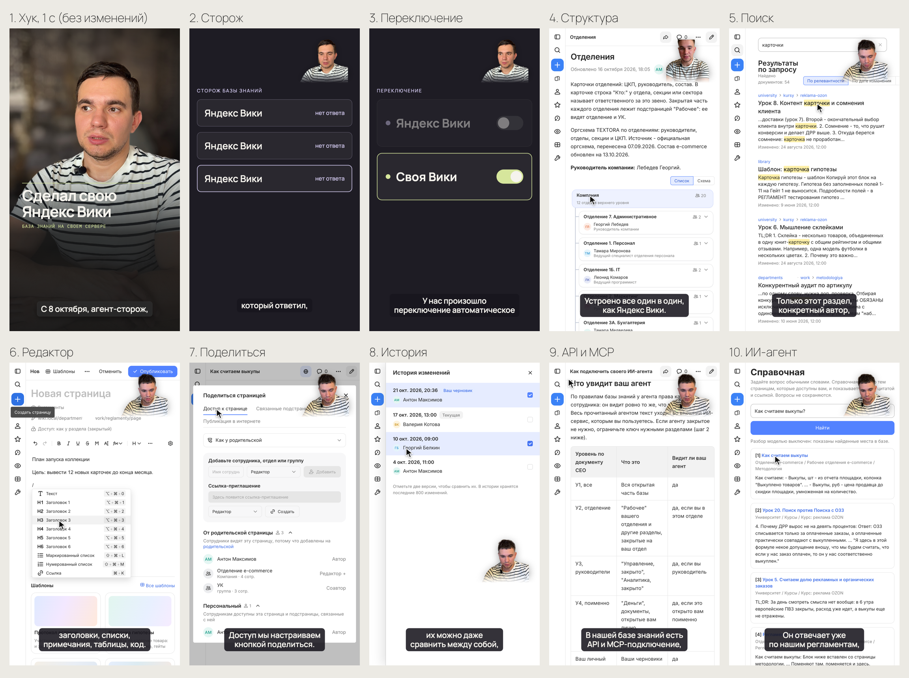
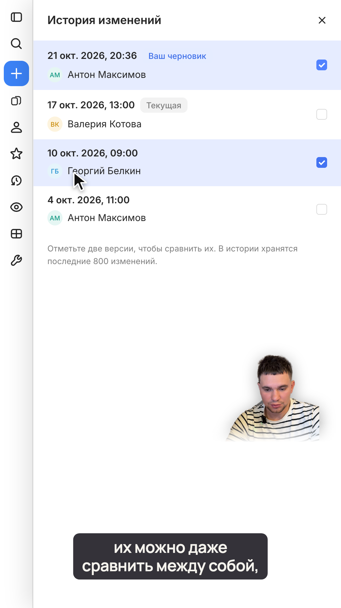
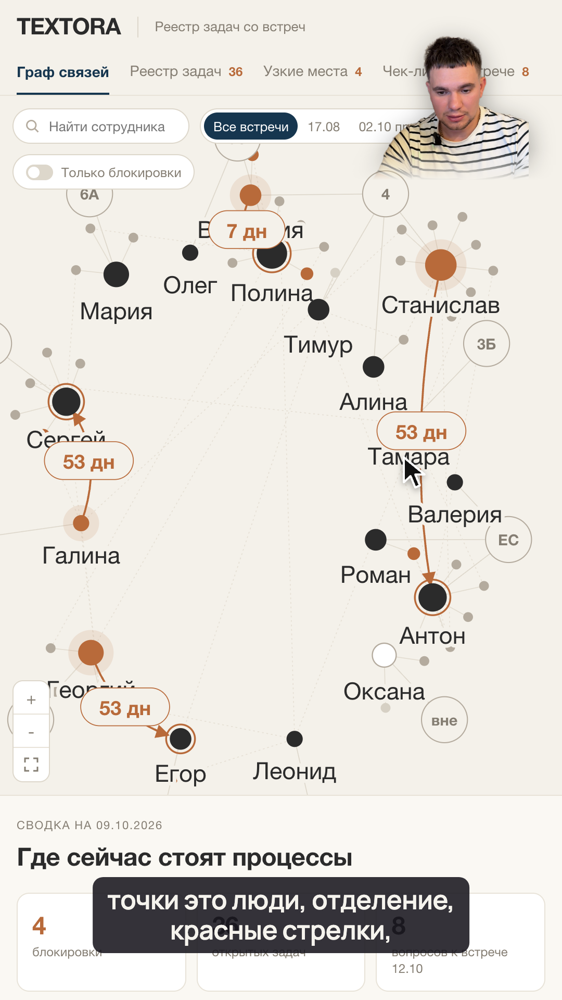

# Видеомонтаж

Скилл для Claude Code, который монтирует вертикальные ролики-обзоры продукта: рилсы, YouTube Shorts, VK Клипы. Автор говорит на камеру, продукт показан записью экрана во весь кадр, автор живой вырезкой в углу, субтитры внизу. Без видеоредактора: монтаж описан в одном конфиге, кадры рисует HTML-страница, рендер покадровый.

Сделано в агентстве [AXIMA AI](https://axima-ai.ru) на живом проекте: два рилса про собственную базу знаний, октябрь 2026. Все правила и ловушки в `SKILL.md` проверены на реальной съемке.



## Для кого

- Для тех, кто снимает обзоры своего сервиса, SaaS, бота или внутреннего инструмента и не хочет сидеть в монтажке.
- Для авторов каналов, которые снимают говорящую голову и показывают экран.
- Для разработчиков агентов: скилл показывает, как разложить видеомонтаж на шаги, которые агент делает сам, а человек только утверждает.

## Какие ролики получаются

| Мокап кадра: история правок | Мокап кадра: граф задач |
|---|---|
|  |  |

- Экран снят как с телефона: вертикальное окно 540x960 в 2x, ничего не обрезано.
- Курсор делает то, о чем автор говорит в эту секунду: действия привязаны к времени слов.
- Автор без фона и рамки: голова справа сверху, ниже плеч растворяется. Если закрывает кнопку, на которую нажимаем, переезжает.
- Хук 1 с и финальная карточка 1 с, ролик до 48 с, звук -14 LUFS.
- Две версии финала: для VK и Shorts (вопрос в комментарии) и для Instagram ("сохрани").

Лист кадров второго ролика: [examples/02_kadry_rils_2.png](examples/02_kadry_rils_2.png). Весь демо-контент на картинках обезличен: бренд и сотрудники вымышленные.

## Как это работает

1. **Расшифровка** каждого дубля с временем слов (faster-whisper large-v3-turbo).
2. **Выбор кусков** речи в конфиге: дубль, первое и последнее слово.
3. **Склейка**: рез по самой тихой точке между словами, паузы сжимаются до 0,28 с, мычания и оговорки вырезаются, шумодав DeepFilterNet, ускорение 1,08, громкость -14 LUFS.
4. **Автор**: кадр 1080x1920 из вертикального видео iPhone и вырезка без фона (RobustVideoMatting).
5. **Обезличенная демо-копия** продукта: бренд, фамилии во всех склонениях, логины и почты меняются на вымышленные.
6. **Мокапы каждого кадра** до записи и рендера: лист кадров на утверждение. Правка мокапа стоит минуту, правка рендера полчаса.
7. **Запись экрана** в вертикальном окне Playwright + CDP screencast, видимый курсор, действия по времени речи.
8. **Страница ролика** (GSAP, детерминированный `renderAt(t)`) и покадровый рендер в mp4 со звуком.
9. **Проверка**: лист кадров по каждой секунде, сверка швов повторным распознаванием, громкость, скан запрещенных символов и слов.

## Установка

```bash
git clone https://github.com/axima29/videomontazh ~/.claude/skills/videomontazh
cd ~/.claude/skills/videomontazh/scripts && npm install
```

Claude Code подхватит скилл сам: достаточно попросить "смонтируй рилс по записи" или "сделай шортс про продукт с записью экрана".

### Зависимости

- ffmpeg и ffprobe в PATH.
- Google Chrome (путь можно задать переменной `CHROME`).
- Node 18+.
- Python 3.10+ и пакеты:

```bash
pip install faster-whisper deepfilternet torch opencv-python numpy scipy pillow
```

Модель вырезки RobustVideoMatting скачивается через `torch.hub` при первом запуске. На Mac с Apple Silicon считается на MPS, на других машинах на CUDA или CPU.

## Пошаговый пример

```bash
S=~/.claude/skills/videomontazh/scripts
mkdir -p ~/video/obzor && cd ~/video/obzor
cp ~/.claude/skills/videomontazh/config.example.py config.py   # вписать пути дублей в TAKES

python $S/transcribe.py A                 # расшифровка дубля A
python $S/words.py A 150 200              # слова с временем: по ним заполнить pieces
python $S/prep.py r1_demo --stage audio   # звук: склейка, шумодав, -14 LUFS
python $S/prep.py r1_demo --stage frames  # кадры автора и фон
python $S/prep.py r1_demo --stage cut     # вырезка автора
python $S/prep.py r1_demo --stage data    # слова, субтитры, сверка швов в reels/r1_demo/speech.txt

# мокапы кадров на утверждение
node $S/mock_shots.cjs states.cjs                 # снимки состояний продукта
python $S/mock_cut.py r1_demo 19 35               # вырезка автора в эти моменты
python $S/mock_compose.py r1_demo                 # лист mock/sheet_r1_demo.png

# после утверждения: запись экрана под фразы
BASE_URL=http://127.0.0.1:8080 OUT=screen/clips node $S/rec.cjs screen/scenes/search.cjs
python $S/resample.py search --clips screen/clips

# страница, стоп-кадры, рендер, проверка
python $S/build_page.py r1_demo
node $S/still.cjs . r1_demo 3 19 35
cd reels/r1_demo && node $S/capture.mjs --html index.html --w 1080 --h 1920 --audio audio.wav --crf 18 --out "../../out/Обзор (VK и Shorts).mp4" && cd ../..
$S/check.sh "out/Обзор (VK и Shorts).mp4"
python $S/scan_text.py config.py reels/r1_demo/speech.txt
```

Полный порядок работы, правила раскладки и ловушки инструментов: [SKILL.md](SKILL.md).

## Что в репозитории

```
SKILL.md              порядок работы для Claude Code
config.example.py     образец конфига проекта
scripts/              расшифровка, звук, кадры, вырезка, запись экрана, мокапы, рендер, проверки
templates/            страница ролика (reel2.js, reel2.css, screen.js, figure.js), образцы сцены и состояний
examples/             мокапы кадров с реального проекта (обезличенные)
```

Сырых видео, звука, баз и клиентских данных в репозитории нет.

---

## English

**Videomontazh** is a Claude Code skill for editing vertical product-review videos (Reels, YouTube Shorts, VK Clips) without a video editor. The author talks to the camera, the product is shown as a full-frame vertical screen recording, the author is cut out of the background and placed in the top-right corner, captions sit at the bottom.

Pipeline: word-level transcription (faster-whisper large-v3-turbo), choosing speech pieces in a config file, cutting pauses and filler sounds at the quietest point between words, DeepFilterNet denoise, -14 LUFS loudness, background removal (RobustVideoMatting), anonymized demo copy of the product, vertical 540x960 @2x screen recording with Playwright + CDP screencast synced to speech, per-frame mockups approved before rendering, deterministic frame-by-frame render of an HTML/GSAP page to mp4, and final checks (contact sheet per second, seam check by re-transcribing the edited audio, loudness, text scan).

Install:

```bash
git clone https://github.com/axima29/videomontazh ~/.claude/skills/videomontazh
cd ~/.claude/skills/videomontazh/scripts && npm install
pip install faster-whisper deepfilternet torch opencv-python numpy scipy pillow
```

Requires ffmpeg, Google Chrome, Node 18+, Python 3.10+. The workflow and tool pitfalls are documented in Russian in `SKILL.md`; Claude Code reads it in any language.

Made by [AXIMA AI](https://axima-ai.ru). License: MIT.
